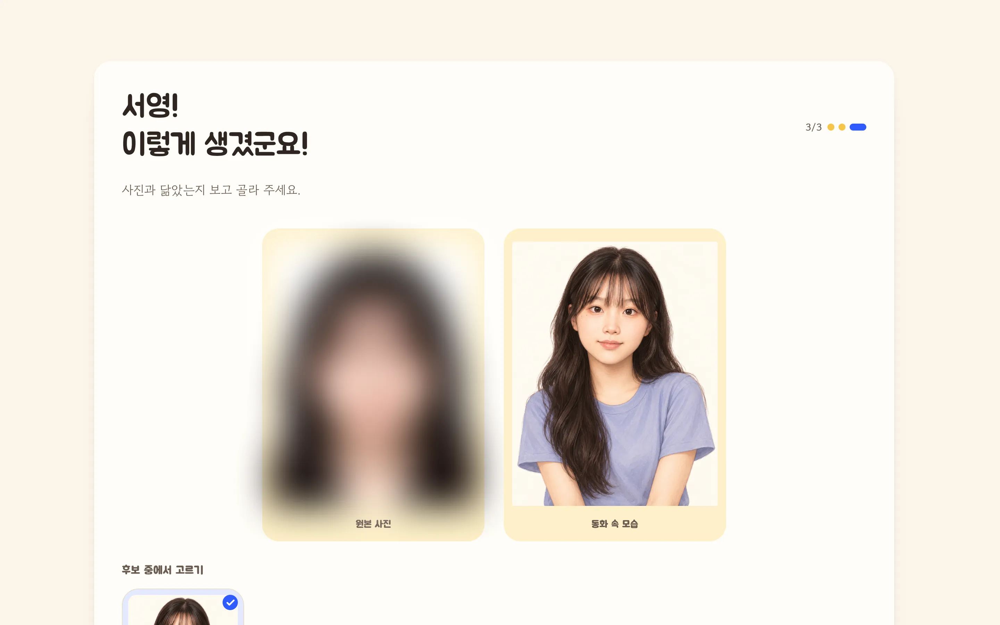
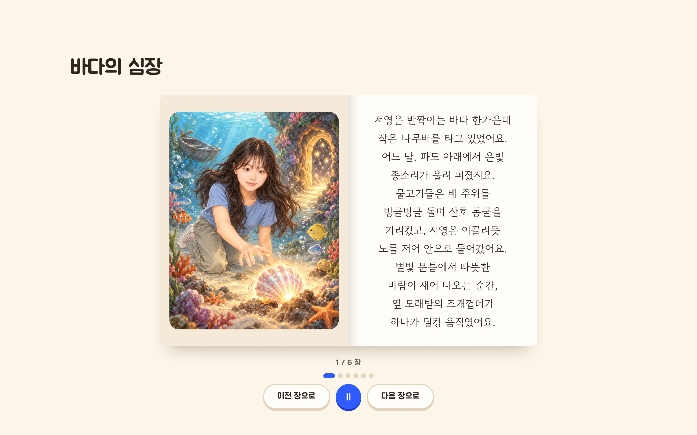

<section class="cover">
<p class="kicker">꿈도깨비 v0.1 · 삽화 얼굴 유지 검증</p>

# 꿈도깨비 삽화 얼굴 유지 검증 보고서

<p class="sub">사진 1장으로 만든 동화 삽화에서 얼굴이 유지되는지, 생성 방식 비교와 프롬프트 개선 결과</p>
<div class="meta">
<p><strong>독자</strong>: 대표님(생성 방식 결정용) · <strong>작성</strong>: 이서영 · 2026-10-07</p>
<p><strong>기준</strong>: 비교 실험 2026-10-03, 개선 실험과 얼굴 측정 2026-10-07 KST · 입력 사진 1장(성인 1명, 보고서 수록 동의)</p>
</div>
</section>

> **목적**: 아이 사진의 얼굴이 동화 삽화에서 유지되는지 생성 방식별로 검증하고, 개선한 생성 방식의 효과와 적용 조건 보고
>
> **구성**: 1장 검증 대상, 2장 실험 설계·해석 기준, 3장 비교 실험 결과, 4장 얼굴 유사도 개선, 5장 얼굴이 달라지는 조건과 재생성, 6장 한계·향후 계획, 부록 프롬프트·재현 방법

## 요약

- **개요**: 사진 1장으로 만든 동화 삽화의 얼굴 유지 검증. 기존 방식 2종과 GPT Image 참조 방식 3종 비교(그림 65장) 후, 프롬프트·얼굴 보정·재생성으로 개선
- **기대 효과**: 별도 얼굴 제어 모델(IP-Adapter) 없이 아이 얼굴이 유지되는 삽화 → 생성 구성 단순화, 이미지 생성용 GPU 서버 불필요
- **현황·수치**: 원본 사진과의 얼굴 유사도(1 = 같은 얼굴, 다른 사람 0.0 안팎, 같은 인물 판정 기준 0.30~0.45) 기존 방식 0.24~0.27 → 현재 서비스 방식 0.34 → 개선 방식 0.51
- **핵심 결과**: 개선 방식은 15칸 중 10칸이 판정 기준 상단(0.45) 이상(현재 방식 6/15). 정면·전신·옷 바뀜 평균 0.45 이상, 옆모습 0.29·크게 웃는 표정 0.449(눈 감은 웃음·옆얼굴은 얼굴 단서가 줄어드는 측정 한계 포함)
- **향후 과제**: 기본 생성 방식을 개선 방식으로 전환 검토(그림 1장당 호출 평균 3.33회, 대기 시간 증가). 아이 사진 여러 명으로 재검증, 사람 확인 병행

<nav class="toc"></nav>

## 1. 검증 대상과 흐름

- **서비스**: 7~9세 아이와 보호자용 맞춤 동화 웹 서비스. 사진 1장 → 기준 캐릭터 생성·보호자 승인 → 장면마다 글·삽화 생성 → 읽기·책장
- **핵심 과제**: 한 권의 모든 삽화에서 같은 아이로 보이기. 이전 버전은 얼굴·외형이 달라지는 문제로 IP-Adapter(얼굴 참조 보조 모델) 사용
- **검증 질문**: 최신 이미지 모델(GPT Image)의 기본 참조 기능만으로 얼굴 유지 가능 여부, 추가 제어 필요 여부
- **실행 환경**: Mac 1대. GPT Image는 ChatGPT 구독 계정의 codex CLI로 호출, 기존 방식은 로컬 ComfyUI

<figure>
<div class="pair"></div>
<figcaption>그림 1. 서비스 화면. 왼쪽 기준 캐릭터 확인(원본 사진은 흐림 처리), 오른쪽 완성 동화 읽기. 2026-10-06 KST 촬영, 폭 1440px(2배)</figcaption>
</figure>

<figure>

<figcaption>그림 2. 비교 실험 흐름과 측정. 방식에 따라 사진, 승인 캐릭터, 또는 둘 다를 참조</figcaption>
</figure>

## 2. 실험 설계

### 비교군

| 비교군 | 생성 방식 | 참조 이미지 | 반복 |
| --- | --- | --- | --- |
| B0 | 기존 방식 원래 그대로 | 사진 | 1회 |
| B1 | 기존 방식 결함 수정본 | 사진 | 3회 |
| G1 | GPT Image | 사진만 | 3회 |
| G2 | GPT Image | 승인 캐릭터만(현재 서비스 기본값) | 3회 |
| G3 | GPT Image | 승인 캐릭터 + 사진 | 3회 |

- **B0·B1 구분**: 기존 방식의 패배 원인을 코드 결함(부정 프롬프트 덮어쓰기, 시드 고정)과 방식 자체로 분리. B0는 시드 고정이라 1회
- **기존 방식 구성**: Stable Diffusion 1.5 계열 toonyou_beta6 + IP-Adapter FaceID Plus v2, 768×768, 30 steps

### 장면 조건

| 장면 | 내용 | 확인 대상 |
| --- | --- | --- |
| 정면 | 숲속 빈터에서 정면을 보고 미소 | 기준점 |
| 옆모습 | 강가 길을 걷는 옆모습 | 얼굴 각도 |
| 크게 웃는 표정 | 축제에서 풍선을 들고 눈을 감은 채 크게 웃음 | 눈·입 모양 변화 |
| 전신 | 비 오는 거리에서 웅덩이를 뛰어넘는 전신 | 작은 얼굴 |
| 옷 바뀜 | 큰 우산 아래 노란 비옷·초록 장화 | 옷이 바뀔 때 인물 유지 |

### 측정 지표

- **얼굴 유사도**: 얼굴 인식 모델(ArcFace)이 뽑은 얼굴 특징의 코사인 유사도. 1에 가까울수록 같은 얼굴. 그림마다 가장 큰 얼굴 1개 사용
  - **사진 유사도**: 원본 사진 ↔ 장면 그림
  - **승인 캐릭터 유사도**: 보호자가 승인한 기준 캐릭터 ↔ 장면 그림. 한 권 안에서 같은 인물 유지 여부
  - **같은 방식 그림끼리**: 같은 방식으로 만든 그림 사이의 평균 유사도(15장 → 105쌍)
- **측정 도구**: insightface buffalo_l(얼굴 검출 + ArcFace), Mac CPU 실행 → 사진·그림 외부 전송 없음
- **사람 평가**: 계획한 3인 블라인드 평가는 진행하지 않음 → 자동 지표로 대체

### 해석 기준

- **다른 사람**: 0.0 안팎. InsightFace 표본 사진 속 6명을 이 사진·그림과 비교한 값 평균 0.02~0.03, 최대 0.21
- **같은 인물 판정 기준**: 0.30~0.45. InsightFace 가이드의 실사 사진 1:1 인증 기준 범위. 그림은 화풍 차이로 실사보다 낮게 나오는 경향 → 보수적 기준
- **승인 캐릭터**: 0.66. 보호자가 같은 인물로 승인한 기준 캐릭터의 실측값

## 3. 비교 실험 결과

<table><thead><tr><th style="text-align:left">비교군</th><th style="text-align:right">사진 유사도 평균 (95% 구간)</th><th style="text-align:right">같은 인물 판정 0.30 이상</th><th style="text-align:right">승인 캐릭터 유사도</th><th style="text-align:right">같은 방식 그림끼리</th><th style="text-align:right">생성 시간 중앙값</th></tr></thead><tbody><tr><td style="text-align:left">B0</td><td style="text-align:right">0.27 (0.20~0.32)</td><td style="text-align:right">2/5</td><td style="text-align:right">0.22</td><td style="text-align:right">0.76</td><td style="text-align:right">28.5초</td></tr><tr><td style="text-align:left">B1</td><td style="text-align:right">0.24 (0.22~0.26)</td><td style="text-align:right">0/15</td><td style="text-align:right">0.24</td><td style="text-align:right">0.83</td><td style="text-align:right">29.1초</td></tr><tr><td style="text-align:left">G1</td><td style="text-align:right">0.47 (0.38~0.55)</td><td style="text-align:right">12/15</td><td style="text-align:right">0.65</td><td style="text-align:right">0.55</td><td style="text-align:right">37.8초</td></tr><tr><td style="text-align:left">G2</td><td style="text-align:right">0.34 (0.27~0.40)</td><td style="text-align:right">9/15</td><td style="text-align:right">0.67</td><td style="text-align:right">0.63</td><td style="text-align:right">38.9초</td></tr><tr><td style="text-align:left">G3</td><td style="text-align:right">0.40 (0.34~0.46)</td><td style="text-align:right">12/15</td><td style="text-align:right">0.72</td><td style="text-align:right">0.64</td><td style="text-align:right">41.9초</td></tr></tbody></table>

- **기존 방식 대비**: GPT 3종 모두 사진에 더 가까움. B1 대비 G1 +0.23·G3 +0.16·G2 +0.10. 같은 장면·회차끼리 짝지은 차이의 95% 구간 모두 0 초과
- **같은 인물 판정**: 기존 방식(B1)은 15장 중 0.30 이상 0장 → 사진과 다른 얼굴. GPT는 G1·G3 각 12·12장, G2 9장
- **참조 방식 간**: 사진을 직접 참조할수록 사진에 가까움(G1 > G3 > G2). 현재 서비스 기본값인 G2가 GPT 중 최저
- **같은 방식 그림끼리**: 기존 방식이 0.76~0.83으로 가장 높지만, 사진과 다른 얼굴을 반복해서 그린 결과(그림 3). GPT는 G3·G2 0.64·0.63, G1 0.55
- **안정성·속도**: 66장(기준 캐릭터 포함) 모두 1회 시도로 생성 성공, 거절·시간 초과 0. 생성 시간 중앙값 기존 28.5~29.1초, GPT 37.8~41.9초

<figure>
<table class="grid compact">
<tr><th></th><th>B0</th><th>B1</th><th>G1</th><th>G2</th><th>G3</th></tr>
<tr><th>정면</th><td><span class="score">0.32</span></td><td><span class="score">0.27</span></td><td><span class="score">0.65</span></td><td><span class="score">0.47</span></td><td><span class="score">0.46</span></td></tr>
<tr><th>옆모습</th><td><span class="score">0.28</span></td><td><span class="score">0.24</span></td><td><span class="score">0.14</span></td><td><span class="score">0.06</span></td><td><span class="score">0.32</span></td></tr>
<tr><th>크게 웃는 표정</th><td><span class="score">0.33</span></td><td><span class="score">0.20</span></td><td><span class="score">0.39</span></td><td><span class="score">0.31</span></td><td><span class="score">0.37</span></td></tr>
<tr><th>전신</th><td><span class="score">0.14</span></td><td><span class="score">0.15</span></td><td><span class="score">0.60</span></td><td><span class="score">0.46</span></td><td><span class="score">0.50</span></td></tr>
<tr><th>옷 바뀜</th><td><span class="score">0.25</span></td><td><span class="score">0.26</span></td><td><span class="score">0.61</span></td><td><span class="score">0.48</span></td><td><span class="score">0.51</span></td></tr>
</table>
<figcaption>그림 3. 비교 실험 결과(1회차). 그림 아래 숫자는 원본 사진과의 얼굴 유사도. 원본 사진과 승인 캐릭터는 그림 5 참고</figcaption>
</figure>

## 4. 얼굴 유사도 개선

- **목표**: 장면 문장과 측정 방식은 그대로 두고 생성 쪽만 개선. 장면별 평균 사진 유사도 0.45(판정 기준 상단) 이상
- **방법**: 프롬프트·참조 구성 6개 버전을 5장면 × 2회로 시험 → 효과가 확인된 요소를 묶은 3단계 방식을 5장면 × 3칸(칸마다 후보 최대 3개)으로 실행. 버전별 변경 내용과 이유는 `docs/prompt-tuning.md`
- **실행 규모**: 개선 실험 전체 호출 240회(그림 생성·보정), 실패 0건. 2026-10-07 KST

### 시험한 버전

<table><thead><tr><th style="text-align:left">버전</th><th style="text-align:left">바꾼 것</th><th style="text-align:right">장수</th><th style="text-align:right">사진 유사도</th><th style="text-align:right">0.45 이상</th><th style="text-align:right">승인 캐릭터 유사도</th><th style="text-align:right">그림끼리</th></tr></thead><tbody><tr><td style="text-align:left">v1-G2</td><td style="text-align:left">비교 실험 G2</td><td style="text-align:right">15</td><td style="text-align:right">0.34</td><td style="text-align:right">6/15</td><td style="text-align:right">0.67</td><td style="text-align:right">0.63</td></tr><tr><td style="text-align:left">v1-G3</td><td style="text-align:left">비교 실험 G3</td><td style="text-align:right">15</td><td style="text-align:right">0.40</td><td style="text-align:right">7/15</td><td style="text-align:right">0.72</td><td style="text-align:right">0.64</td></tr><tr><td style="text-align:left">v1-G1</td><td style="text-align:left">비교 실험 G1</td><td style="text-align:right">15</td><td style="text-align:right">0.47</td><td style="text-align:right">8/15</td><td style="text-align:right">0.65</td><td style="text-align:right">0.55</td></tr><tr><td style="text-align:left">v2</td><td style="text-align:left">닮음 우선 지시·얼굴 묘사문·미화 금지, 사진 먼저 참조</td><td style="text-align:right">10</td><td style="text-align:right">0.48</td><td style="text-align:right">6/10</td><td style="text-align:right">0.76</td><td style="text-align:right">0.66</td></tr><tr><td style="text-align:left">v3a</td><td style="text-align:left">v2 + 사진만 참조(승인 캐릭터 참조 제거)</td><td style="text-align:right">10</td><td style="text-align:right">0.52</td><td style="text-align:right">6/10</td><td style="text-align:right">0.67</td><td style="text-align:right">0.58</td></tr><tr><td style="text-align:left">v3b</td><td style="text-align:left">v2 + 얼굴만 반실사 화풍</td><td style="text-align:right">10</td><td style="text-align:right">0.46</td><td style="text-align:right">7/10</td><td style="text-align:right">0.75</td><td style="text-align:right">0.66</td></tr><tr><td style="text-align:left">v4</td><td style="text-align:left">v2 그림의 얼굴만 사진에 맞게 다시 그리기(2단계)</td><td style="text-align:right">10</td><td style="text-align:right">0.57</td><td style="text-align:right">6/10</td><td style="text-align:right">0.69</td><td style="text-align:right">0.57</td></tr><tr><td style="text-align:left">v4b</td><td style="text-align:left">v3a 그림 + 표정 유지 얼굴 보정</td><td style="text-align:right">10</td><td style="text-align:right">0.53</td><td style="text-align:right">6/10</td><td style="text-align:right">0.65</td><td style="text-align:right">0.55</td></tr><tr><td style="text-align:left">v5</td><td style="text-align:left">v2 + 허리 위 구도 규칙</td><td style="text-align:right">10</td><td style="text-align:right">0.43</td><td style="text-align:right">6/10</td><td style="text-align:right">0.72</td><td style="text-align:right">0.62</td></tr><tr><td style="text-align:left">개선 방식</td><td style="text-align:left">생성 → 얼굴 보정 → 측정·재생성(3단계), 선택 15칸</td><td style="text-align:right">15</td><td style="text-align:right">0.51</td><td style="text-align:right">10/15</td><td style="text-align:right">0.73</td><td style="text-align:right">0.63</td></tr><tr><td style="text-align:left">v6</td><td style="text-align:left">개선 방식 + 웃음·옆얼굴 단서 문장, 선택 15칸</td><td style="text-align:right">15</td><td style="text-align:right">0.51</td><td style="text-align:right">11/15</td><td style="text-align:right">0.70</td><td style="text-align:right">0.60</td></tr></tbody></table>

- **효과 있음**: 닮음 우선 지시·얼굴 묘사문·미화 금지(v2, 같은 참조 구성의 G3 대비 상승), 생성 뒤 얼굴만 다시 그리는 2단계 보정(v4, 얼굴이 보이는 장면에서 상승)
- **채택하지 않음**: 사진만 참조(v3a·v4b). 사진 유사도는 높지만 정면 미소가 무표정으로 바뀌고 지시에 없는 옷이 나옴 → 장면 충실도 하락. 반실사 화풍(v3b)과 구도 규칙(v5)은 효과 없음

### 개선 방식

- **1단계 생성**: 사진(얼굴 기준)과 승인 캐릭터(화풍·옷 기준)를 함께 참조. 닮음 우선 지시, 사진에서 뽑은 얼굴 묘사문, 미화 금지 포함
- **2단계 얼굴 보정**: 1단계 그림의 구도·자세·표정·옷·배경은 그대로 두고 얼굴만 사진에 맞게 다시 그리기. 보정 전·후 중 사진 유사도가 높은 쪽 채택
- **3단계 측정·재생성**: 채택한 그림이 0.45 미만이면 1단계부터 다시(최대 3회). 기준을 넘는 첫 후보, 없으면 3개 중 최고값 채택. 측정은 Mac에서 1장당 1초 미만

<table><thead><tr><th style="text-align:left">단계</th><th style="text-align:right">사진 유사도 평균</th><th style="text-align:right">0.45 이상</th><th style="text-align:right">승인 캐릭터 유사도</th><th style="text-align:right">그림 1장당 호출</th></tr></thead><tbody><tr><td style="text-align:left">현재 서비스 방식(G2)</td><td style="text-align:right">0.34</td><td style="text-align:right">6/15</td><td style="text-align:right">0.67</td><td style="text-align:right">1회</td></tr><tr><td style="text-align:left">1단계: 프롬프트 개선(첫 후보)</td><td style="text-align:right">0.43</td><td style="text-align:right">8/15</td><td style="text-align:right">0.74</td><td style="text-align:right">1회</td></tr><tr><td style="text-align:left">1·2단계: + 얼굴 보정(첫 후보)</td><td style="text-align:right">0.49</td><td style="text-align:right">10/15</td><td style="text-align:right">0.71</td><td style="text-align:right">2회</td></tr><tr><td style="text-align:left"><strong>1~3단계: + 재생성(개선 방식)</strong></td><td style="text-align:right"><strong>0.51</strong></td><td style="text-align:right"><strong>10/15</strong></td><td style="text-align:right"><strong>0.73</strong></td><td style="text-align:right"><strong>평균 3.33회</strong></td></tr></tbody></table>

- **단계별 효과**: 현재 방식 0.34 → 프롬프트 개선 0.43 → 얼굴 보정 0.49 → 재생성 0.51
- **같은 인물 유지**: 승인 캐릭터 유사도 0.67 → 0.73, 그림끼리 0.63 유지. 사진에 가까워지면서도 한 권 안의 같은 인물 유지 수준은 같거나 높음
- **재현성**: 같은 3단계 방식을 독립적으로 한 번 더 실행(v6, 웃는 표정·옆얼굴 단서 문장 추가) → 0.51, 0.45 이상 11/15칸 → 결과 재현, 단서 문장 효과 없음
- **비용·시간**: 그림 1장당 호출 평균 3.33회(생성·보정 각 1.67회). 호출 1회 중앙값 생성 62.6초·보정 59.3초(동시 9개 실행 조건) → 순차 처리 시 장당 약 3.4분

<figure>
<svg viewBox="0 0 640 250" width="100%" role="img" aria-label="방식별 사진 유사도와 해석 기준" xmlns="http://www.w3.org/2000/svg" font-family="Pretendard, sans-serif">
<rect x="324.75" y="16" width="87.375" height="202" fill="#e3e9ff"/>
<text x="368.4375" y="28" text-anchor="middle" font-size="9.5" fill="#2f5bff" font-weight="600">같은 인물 판정 기준 0.30~0.45</text>
<rect x="150" y="16" width="122.32499999999999" height="202" fill="#f3f4f6"/>
<text x="211.1625" y="28" text-anchor="middle" font-size="9.5" fill="#6b7280">다른 사람 0~0.21</text>
<line x1="150" y1="34" x2="150" y2="218" stroke="#e5e7eb"/><text x="150" y="232" text-anchor="middle" font-size="9.5" fill="#6b7280">0.0</text><line x1="266.5" y1="34" x2="266.5" y2="218" stroke="#e5e7eb"/><text x="266.5" y="232" text-anchor="middle" font-size="9.5" fill="#6b7280">0.2</text><line x1="383" y1="34" x2="383" y2="218" stroke="#e5e7eb"/><text x="383" y="232" text-anchor="middle" font-size="9.5" fill="#6b7280">0.4</text><line x1="499.49999999999994" y1="34" x2="499.49999999999994" y2="218" stroke="#e5e7eb"/><text x="499.49999999999994" y="232" text-anchor="middle" font-size="9.5" fill="#6b7280">0.6</text><line x1="616" y1="34" x2="616" y2="218" stroke="#e5e7eb"/><text x="616" y="232" text-anchor="middle" font-size="9.5" fill="#6b7280">0.8</text>
<line x1="534.45" y1="16" x2="534.45" y2="218" stroke="#111827" stroke-dasharray="4 3"/>
<text x="538.45" y="28" font-size="9.5" fill="#111827">승인 캐릭터 0.66</text>
<text x="142" y="48" text-anchor="end" font-size="10.5" fill="#1f2937">다른 사람(대조군)</text>
<rect x="150" y="38" width="17.474999999999994" height="13" rx="2" fill="#cfd4dc"/>
<text x="172.475" y="48" font-size="10" fill="#374151">0.03</text>
<text x="142" y="70" text-anchor="end" font-size="10.5" fill="#1f2937">B1 기존 방식</text>
<rect x="150" y="60" width="139.77708013355732" height="13" rx="2" fill="#9aa3b2"/>
<text x="294.7770801335573" y="70" font-size="10" fill="#374151">0.24</text>
<text x="142" y="92" text-anchor="end" font-size="10.5" fill="#1f2937">G2 현재 서비스 방식</text>
<rect x="150" y="82" width="197.30225593596697" height="13" rx="2" fill="#9db2ff"/>
<text x="352.30225593596697" y="92" font-size="10" fill="#374151">0.34</text>
<text x="142" y="114" text-anchor="end" font-size="10.5" fill="#1f2937">G3 캐릭터+사진</text>
<rect x="150" y="104" width="234.07217575609684" height="13" rx="2" fill="#9db2ff"/>
<text x="389.07217575609684" y="114" font-size="10" fill="#374151">0.40</text>
<text x="142" y="136" text-anchor="end" font-size="10.5" fill="#1f2937">G1 사진만</text>
<rect x="150" y="126" width="274.48092325280106" height="13" rx="2" fill="#9db2ff"/>
<text x="429.48092325280106" y="136" font-size="10" fill="#374151">0.47</text>
<text x="142" y="158" text-anchor="end" font-size="10.5" fill="#1f2937">1단계 프롬프트 개선</text>
<rect x="150" y="148" width="251.44047469397384" height="13" rx="2" fill="#2f5bff"/>
<text x="406.44047469397384" y="158" font-size="10" fill="#374151">0.43</text>
<text x="142" y="180" text-anchor="end" font-size="10.5" fill="#1f2937">1·2단계 + 얼굴 보정</text>
<rect x="150" y="170" width="285.9483431999882" height="13" rx="2" fill="#2f5bff"/>
<text x="440.9483431999882" y="180" font-size="10" fill="#374151">0.49</text>
<text x="142" y="202" text-anchor="end" font-size="10.5" fill="#1f2937" font-weight="700">개선 방식(1~3단계)</text>
<rect x="150" y="192" width="295.3434648613135" height="13" rx="2" fill="#2f5bff"/>
<text x="450.3434648613135" y="202" font-size="10" fill="#374151" font-weight="700">0.51</text>
<text x="383" y="246" text-anchor="middle" font-size="9.5" fill="#6b7280">원본 사진과의 얼굴 유사도(평균)</text>
</svg>
<figcaption>그림 4. 방식별 원본 사진 유사도와 해석 기준. 회색은 다른 사람 수준, 파란 띠는 같은 인물 판정 기준</figcaption>
</figure>

<figure>
<table class="grid">
<tr><th></th><td><span class="score">원본 사진</span></td><td><span class="score">승인 캐릭터 0.66</span></td><td></td><td></td><td></td></tr>
<tr><th></th><th>정면</th><th>옆모습</th><th>크게 웃는 표정</th><th>전신</th><th>옷 바뀜</th></tr>
<tr><th>현재 방식<br>(G2)</th><td><span class="score">0.47</span></td><td><span class="score">0.06</span></td><td><span class="score">0.31</span></td><td><span class="score">0.46</span></td><td><span class="score">0.48</span></td></tr>
<tr><th>개선 방식</th><td><span class="score">0.59</span></td><td><span class="score">0.31 · 보정 · 3회 중 최고</span></td><td><span class="score">0.47</span></td><td><span class="score">0.58 · 보정</span></td><td><span class="score">0.54 · 보정</span></td></tr>
</table>
<figcaption>그림 5. 현재 서비스 방식(G2, 1회차)과 개선 방식(1칸)의 장면별 그림. 숫자는 원본 사진과의 얼굴 유사도</figcaption>
</figure>

## 5. 얼굴이 달라지는 조건과 재생성

<table><thead><tr><th style="text-align:left">장면</th><th style="text-align:right">B1 기존</th><th style="text-align:right">G2 현재</th><th style="text-align:right">G3</th><th style="text-align:right">G1</th><th style="text-align:right">개선 방식</th></tr></thead><tbody><tr><td style="text-align:left">정면</td><td style="text-align:right">0.27</td><td style="text-align:right">0.48</td><td style="text-align:right">0.51</td><td style="text-align:right">0.65</td><td style="text-align:right"><strong>0.55</strong></td></tr><tr><td style="text-align:left">옆모습</td><td style="text-align:right">0.27</td><td style="text-align:right">0.13</td><td style="text-align:right">0.24</td><td style="text-align:right">0.19</td><td style="text-align:right"><strong>0.29</strong></td></tr><tr><td style="text-align:left">크게 웃는 표정</td><td style="text-align:right">0.23</td><td style="text-align:right">0.28</td><td style="text-align:right">0.32</td><td style="text-align:right">0.38</td><td style="text-align:right"><strong>0.449</strong></td></tr><tr><td style="text-align:left">전신</td><td style="text-align:right">0.18</td><td style="text-align:right">0.36</td><td style="text-align:right">0.42</td><td style="text-align:right">0.53</td><td style="text-align:right"><strong>0.62</strong></td></tr><tr><td style="text-align:left">옷 바뀜</td><td style="text-align:right">0.25</td><td style="text-align:right">0.44</td><td style="text-align:right">0.51</td><td style="text-align:right">0.59</td><td style="text-align:right"><strong>0.62</strong></td></tr></tbody></table>

- **옆모습**: GPT 방식·개선 방식에서 최저(기존 방식은 전신이 최저). GPT 그림의 옆모습 얼굴은 화면의 평균 1.3%(9장 중 7장 1% 미만, 정면 평균 5~7%)이고, 완전한 옆얼굴일수록 값이 낮음(v5 완전한 옆얼굴 0.16~0.19, v2 반측면 0.29~0.31) → 정면 사진 기준 얼굴 인식의 측정 한계와 실제 변형이 섞인 값. 개선 방식 0.29, 최고 칸 0.36
- **크게 웃는 표정**: 눈을 감고 입을 크게 벌려 눈매 단서 감소 → 두 번째로 낮음. 개선 방식 0.449. 닮음 우선 지시·반실사·얼굴 보정·단서 문장을 모두 시도해도 0.45 안팎 → 무표정 증명사진과 비교하는 측정의 한계 포함
- **전신·옷 바뀜**: 얼굴이 작아도 2단계 보정 효과가 가장 큼(첫 후보 기준 전신 +0.17·옷 바뀜 +0.08). 옷이 바뀌어도 얼굴 유지
- **정면**: 현재 방식 0.48 → 개선 방식 0.55
- **재생성이 필요한 경우**: 생성 실패(거절·시간 초과·그림 없음)는 비교 실험 66건·개선 실험 240건 모두 0건. 얼굴 기준(0.45) 미달로 다시 생성한 칸은 옆모습 3칸·크게 웃는 표정 2칸 → 옆모습·크게 웃는 표정이 재생성 대상. 보정본 채택 8칸/15칸

## 6. 한계와 향후 계획

### 한계

- **표본**: 사진 1장, 성인 1명의 결과 → 실제 대상인 7~9세 아이와 여러 사람으로 일반화 불가
- **측정 지표**: 얼굴 인식 모델(ArcFace)은 실사 얼굴용 → 그림체·옆얼굴에서 값이 낮게 나옴. 사람의 판단과 일치하는지 미확인(3인 블라인드 평가 미실시)
- **선택과 평가에 같은 지표**: 3단계 재생성과 2단계 보정 선택이 평가와 같은 지표로 후보를 고름 → 최종 수치는 이 지표 기준으로 낙관적. 다른 얼굴 인식 모델이나 사람 확인으로 교차 검증 필요
- **장면 충실도**: 얼굴 보정 때 표정이 무표정 쪽으로 바뀐 사례 확인(v4 정면) → 표정 유지 문장 추가. 자동 지표로는 표정을 확인하지 못함 → 그림 확인 병행
- **비용·시간**: 호출 수가 현재 방식의 약 3.33배 → 장면당 대기 시간 증가. 구독 사용률 기준의 장당 비용은 측정되지 않음(실험 중 사용률 0~1%로 표시)

### 향후 계획(조건부)

- **기본 방식 전환**: 개선 방식으로 전환 검토. 조건: 장면당 대기 시간을 미리 생성·병렬 처리로 감당 가능할 때
- **보정 범위 축소**: 2단계 보정은 효과가 큰 장면(전신·옷 바뀜 등 얼굴이 작은 장면)부터 적용 → 호출 수 절감
- **재검증**: 보호자 동의를 받은 아이 사진 3~5명으로 같은 조건 재측정, 사람 확인 병행 여부 결정
- **비용 실측**: 배포용 OpenAI API 연결 후 장당 비용 측정

## 부록

### A. 개선 방식 프롬프트 틀

1단계 생성(`{scene}` 장면 문장, `{face_desc}` 얼굴 묘사문, `{char_look}` 특징 문장, `{outfit_rule}` 옷 규칙, `{reference_lines}` 참조 경로)

```text
Create exactly one children's storybook illustration. Use the image generation tool exactly once.
Scene: {scene}
Main character: the same real person as in the reference photo. A recognizable likeness of this person's face is the top priority, above style.
Face (from the photo): {face_desc}
Keep the face shape, jawline, eye shape and spacing, eyebrow shape, nose, lips, bangs and hairline exactly as in the photo. Do not beautify or idealize the face, do not enlarge the eyes, do not slim or shrink the face, and do not change the apparent age.
Keep the face clearly visible and drawn with detail even when the character is small in the frame. Do not cover the face with hair, hands or objects.
Appearance: {char_look}
Outfit: {outfit_rule}
Style: soft, warm storybook illustration, consistent with the reference character image. One character only. No text, no watermark, no border. Portrait orientation.
Permission: the person shown in the reference image(s), or their guardian, has agreed to this use of their likeness.
Reference images (pass every path in referenced_image_paths):
{reference_lines}
Do not run shell commands. Do not edit files. When the tool returns, answer with JSON only.
```

2단계 얼굴 보정

```text
Edit the first reference image, a children's storybook illustration. Use the image generation tool exactly once.
Keep the composition, pose, head angle, expression, clothing, background, framing and art style of the first image unchanged.
Keep the facial expression of the first image exactly (for example a smile, laughing with closed eyes, or a calm look), and redraw only the identity of the character's face and hairline so that the character is a recognizable likeness of the real person in the second reference image (photo).
Face (from the photo): {face_desc}
Keep the face shape, jawline, eye shape and spacing, eyebrow shape, nose, lips, bangs and hairline exactly as in the photo. Do not beautify or idealize the face, do not enlarge the eyes and do not change the apparent age.
Scene of the first image, for context: {scene}
One character only. No text, no watermark, no border. Portrait orientation.
Permission: the person shown in the reference image(s), or their guardian, has agreed to this use of their likeness.
Reference images (pass every path in referenced_image_paths):
{reference_lines}
Do not run shell commands. Do not edit files. When the tool returns, answer with JSON only.
```

얼굴 묘사문(사진에서 1회 생성)

```text
She appears to be a young adult with a softly oval face, gently rounded jaw, and a small, rounded chin. Her forehead is partly covered by wispy, center-parted bangs; long, dark brown to black hair falls in loose, subtly wavy strands around her face. She has straight, fine-to-medium brows and large, dark brown eyes with subtle upper-lid creases, a level set, and slight upward outer corners. Her nose has a straight, narrow bridge and softly rounded tip; her lips are medium-full with a defined cupid’s bow, and faint small freckles or moles dot her right cheek (viewer’s left).
```

### B. 측정·재현

- **측정**: `.local/ComfyUI/.venv/bin/python scripts/face-sim.py`(비교 실험), 같은 명령에 `--dir data/lab/tuning/<버전>`(개선 실험), `--control`(대조군, InsightFace 표본 사진 속 6명 → `data/lab/report/face-control.json`). insightface 2.0, onnxruntime 1.30.0, numpy 2.5.3, buffalo_l(det_10g + w600k_r50), CPU, 검출 크기 640. 그림마다 가장 큰 얼굴 1개
- **구간**: 평균의 95% 구간은 부트스트랩 1만 회(seed 0). 비교군 차이는 같은 장면·회차끼리 짝지은 차이
- **개선 실험**: 버전 정의 `backend-fastAPI/app/lab/tuning.json`, 실행 `cd backend-fastAPI && uv run python -m app.lab.tune <버전> --first N --rounds M`. 결과 그림·프롬프트 원문·로그는 `data/lab/tuning/<버전>/`
- **보고서**: `bun scripts/report-pdf.ts`(docs/report.md → docs/report.pdf)

### C. 실행 기록

- **비교 실험**: 2026-10-03 10:55~11:38 KST. 매니페스트 66행, 모두 1회 시도로 성공. GPT Image는 codex CLI(2026-10-02 확인 버전 0.157.1), 기존 방식은 ComfyUI(커밋 65787d6)와 ComfyUI_IPAdapter_plus(커밋 a0f451a)
- **개선 실험**: 2026-10-07 KST. 호출 240회, 실패 0건. codex 사용률 1.0%(주간 창 초기화 2026-10-14 16:00 KST)
- **기록 밖 생성**: 비교 실험 중 실행 넘김 과정의 경합으로 1장 추가 생성(집계 제외). 개선 실험 중 감시 시간 제한으로 실행기가 끊겨 진행 중이던 codex 3개를 종료(결과 미회수, 같은 칸은 다시 생성)
